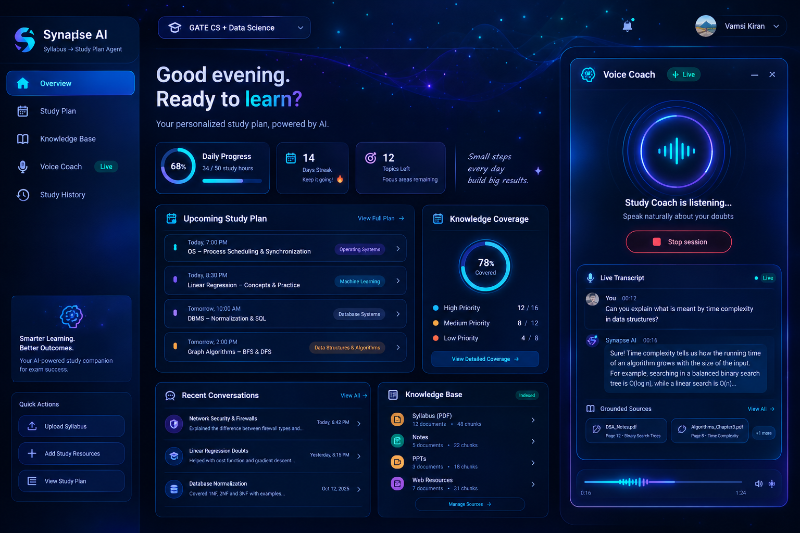
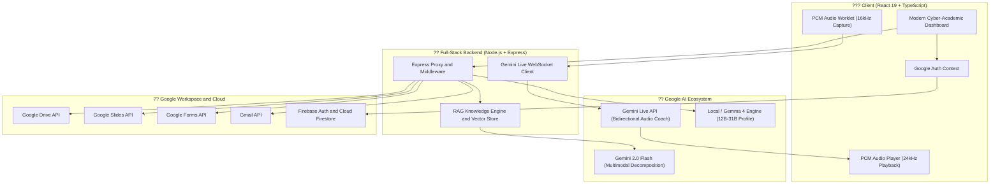

<div align="center">

# ? Synapse AI ? Syllabus to Study Plan Agent

### *Transform Course Syllabi into Intelligent, Adaptive Study Plans with Real-Time Voice Coaching*

[](https://react.dev/)
[](https://www.typescriptlang.org/)
[](https://vitejs.dev/)
[](https://tailwindcss.com/)
[](https://ai.google.dev/)
[](https://firebase.google.com/)
[](LICENSE)

<br/>

[?? Quick Start](#-quick-start) ? [? Key Features](#-key-features) ? [?? System Architecture](#-system-architecture) ? [?? Workflow](#-user-workflow) ? [??? Integrations](#%EF%B8%8F-google-workspace-integrations) ? [?? Project Structure](#-project-structure)

<br/>

<kbd></kbd>

<p align="center"><i>The Synapse AI Master Dashboard featuring cyber-academic visuals, active recall coach, study telemetry, and Google Workspace integrations.</i></p>

</div>

---

## ?? Overview

**Synapse AI** is an agentic, multimodal study companion engineered for ambitious students and self-learners. Rather than producing static to-do lists, Synapse AI deconstructs dense academic syllabi (PDFs or markdown) using **multimodal Gemini models**, builds an indexable **RAG knowledge graph**, and generates an adaptive, milestone-driven study curriculum tailored to the student's exam timeline, difficulty weighting, and weekly bandwidth.

It features a **low-latency Gemini Live Voice Coach** for oral flashcard interrogation and interactive concept drills, along with automated export pipelines into **Google Drive**, **Google Slides**, **Google Forms**, and **Gmail**.

---

## ? Key Features

<table>
  <tr>
    <td width="50%" valign="top">
      <h3>?? Autonomous Syllabus Decomposition</h3>
      <ul>
        <li><b>Multimodal PDF/Text Ingestion</b>: Extracts course milestones, grading rubrics, exam schedules, textbook chapters, and topic prerequisites.</li>
        <li><b>RAG-Augmented Knowledge Engine</b>: Chunks and vectors syllabus topics for grounded, hallucination-free study recommendations.</li>
        <li><b>Adaptive Time Allocator</b>: Weights difficult modules and automatically schedules spaced repetition intervals.</li>
      </ul>
    </td>
    <td width="50%" valign="top">
      <h3>??? Real-Time Voice Study Coach</h3>
      <ul>
        <li><b>Gemini Live Audio Integration</b>: Full-duplex conversational voice checks using bidirectional Web Audio PCM streams.</li>
        <li><b>Voice Recall Quizzes</b>: Spoken active recall sessions with automated speech recognition and instant answer critiques.</li>
        <li><b>Generative AI Tutor</b>: Context-aware chat with support for Google Gemini models and Gemma 4 (12B?31B) parameter local profiles.</li>
      </ul>
    </td>
  </tr>
  <tr>
    <td width="50%" valign="top">
      <h3>?? Google Workspace Automation</h3>
      <ul>
        <li><b>Google Drive</b>: Sync curated reading lists, study notes, and revision checklists directly to Google Drive folders.</li>
        <li><b>Google Slides Generator</b>: Compiles weekly module summaries into beautifully structured presentation decks.</li>
        <li><b>Google Forms Exporter</b>: Transforms study objectives into self-grading diagnostic quizzes.</li>
        <li><b>Gmail Alerts</b>: Scheduled study digests and upcoming exam countdowns delivered to your inbox.</li>
      </ul>
    </td>
    <td width="50%" valign="top">
      <h3>?? Modern Cyber-Academic UX</h3>
      <ul>
        <li><b>Glassmorphic Aesthetics</b>: Tailored obsidian dark mode accented by neon cyan highlights and glowing telemetry cards.</li>
        <li><b>Micro-Animations</b>: Physics-based interactive motion powered by Framer Motion (<code>motion</code>).</li>
        <li><b>Unified Master Schedule</b>: Interactive progress rings, completion tracking, task filtering, and streak telemetry.</li>
      </ul>
    </td>
  </tr>
</table>

---

## ?? System Architecture



---

## ?? User Workflow

```text
  [ ?? 1. Upload Syllabus ]
           ?
           ?
  [ ?? 2. Exam Milestones ] ??? Set final exam dates, midterms, and quiz checkpoints
           ?
           ?
  [ ?? 3. Weekly Bandwidth ] ??? Define daily study hours, rest days, and crunch periods
           ?
           ?
  [ ?? 4. Resource Profile ] ??? Prioritize textbooks, videos, practice problems, or flashcards
           ?
           ?
  [ ?? 5. Master Schedule  ] ??? Dynamic calendar, daily micro-tasks, and streak monitoring
           ??? ??? Voice Coach    ??? Real-time conversational concept drills and active recall
           ??? ?? Workspace Sync ??? Export to Google Drive, Slides, Forms, and Gmail
```

---

## ??? Google Workspace Integrations

| Service | Feature | Output Artifact |
| :--- | :--- | :--- |
| **Google Sign-In** | Custom cyber-academic auth button | Secure OAuth session with Google API scopes |
| **Google Drive** | One-click study repository export | Structured Google Drive study folder with notes and checklists |
| **Google Slides** | Automated lecture slide generation | Multi-slide presentation deck covering syllabus modules |
| **Google Forms** | Active recall test generator | Form quiz complete with multiple-choice questions and answer keys |
| **Gmail** | Automated email digests | Weekly revision agendas and urgent exam countdown alerts |

---

## ?? Quick Start

### Prerequisites
- **Node.js**: v18.0.0 or higher
- **npm** (v9+) or **yarn** / **pnpm**
- **Google Gemini API Key**: [Get a key from Google AI Studio](https://aistudio.google.com/)
- *(Optional)* **Firebase Project**: For persistent cloud storage and Firebase Authentication

### 1. Clone the Repository
```bash
git clone https://github.com/Bvamsikiran/Syllabus-to-Study-Plan-Agent-latest.git
cd Syllabus-to-Study-Plan-Agent-latest
```

### 2. Install Dependencies
```bash
npm install
```

### 3. Configure Environment Variables *(Optional)*
The server will automatically generate a local `.env` from `.env.example` on your first launch.

You can set your Gemini API key in `.env` or input it directly in the web UI header:
```env
# Google Gemini API (Get free key at https://aistudio.google.com/app/apikey)
GEMINI_API_KEY=your_gemini_api_key_here
GEMINI_TEXT_MODEL=gemini-3.5-flash
GEMINI_LIVE_MODEL=gemini-3.8-live

# Server Port (auto-increments if port is busy)
PORT=3000
```

### 4. Run the Application
```bash
npm run dev
```

Visit [`http://localhost:3000`](http://localhost:3000) in your browser.

> **💡 Zero Friction First Run:**
> - Click **"Try Sample Syllabus"** on the upload screen to test instantly with a 4-unit Distributed Systems syllabus.
> - Click the **Key icon** in the top header to enter or test your Gemini API key on the fly.
> - Click **"PDF / Print"** on any generated study plan for instant, offline export (no Google login required).

---

## ?? Available Scripts

| Command | Description |
| :--- | :--- |
| `npm run dev` | Launches the Express server and Vite development bundler with HMR |
| `npm run build` | Compiles optimized production bundle in `/dist` |
| `npm run start` | Executes the production build with `tsx server.ts` |
| `npm run lint` | Performs strict TypeScript type checks (`tsc --noEmit`) |
| `npm run preview` | Previews the production build locally |

---

## ?? Project Structure

```text
Syllabus-to-Study-Plan-Agent/
??? public/                       # Static assets & audio capture worklets
?   ??? pcm-capture-worklet.js   # 16kHz Web Audio capture processor
??? docs/                         # Documentation & media assets
?   ??? assets/
?       ??? dashboard-preview.png # High-res dashboard screenshot
??? src/
?   ??? components/               # Cyber-academic UI components
?   ?   ??? GoogleAuthButton.tsx     # Custom styled Google OAuth component
?   ?   ??? ModernStudyDashboard.tsx # Core master dashboard & study telemetry
?   ?   ??? VoiceStudyCoach.tsx       # Bidirectional Gemini Live voice coach
?   ?   ??? VoiceRecallQuiz.tsx       # Spoken flashcard interrogation engine
?   ?   ??? GenerativeAITutor.tsx     # Multimodal AI chat companion
?   ?   ??? Step1Upload.tsx           # Syllabus document ingestion wizard
?   ?   ??? Step2Exam.tsx             # Exam timeline configuration
?   ?   ??? Step3Bandwidth.tsx        # Weekly study bandwidth allocator
?   ?   ??? Step4Resources.tsx        # Learning style & resource selection
?   ?   ??? GoogleDriveModal.tsx      # Google Drive export integration
?   ?   ??? GoogleSlidesModal.tsx     # Google Slides deck builder
?   ?   ??? GoogleFormsModal.tsx      # Google Forms quiz creator
?   ?   ??? GmailSyncModal.tsx        # Gmail study reminder automation
?   ??? context/                  # React global contexts (GoogleAuthContext)
?   ??? lib/                      # Audio worklets, Live API client & Knowledge base
?   ??? services/                 # Gemini API, RAG, Firebase & Google Workspace APIs
?   ??? types/                    # TypeScript interfaces & domain models
?   ??? App.tsx                   # Main application flow orchestrator
?   ??? index.css                 # Cyber-academic design system tokens & styles
?   ??? main.tsx                  # React 19 root mounting
??? server.ts                     # Express full-stack proxy & Gemini Live bridge
??? package.json                  # Dependencies & scripts
??? tsconfig.json                 # TypeScript compiler configuration
```

---

## ?? Contributing

Contributions are welcomed! Follow these steps to contribute:

1. **Fork** the repository
2. **Create a branch**: `git checkout -b feature/amazing-feature`
3. **Commit your changes**: `git commit -m 'feat: add amazing feature'`
4. **Push to branch**: `git push origin feature/amazing-feature`
5. **Open a Pull Request**

---

## ?? License

Distributed under the **MIT License**. See [`LICENSE`](LICENSE) for more information.

<div align="center">

**Crafted with ? by the Synapse AI Team for the Google Agentic AI Hackathon**

</div>
